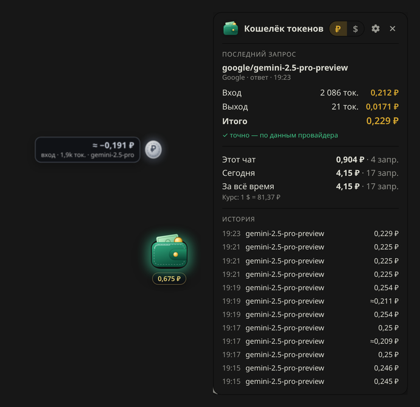

# 💰 Token Wallet — Кошелёк токенов для SillyTavern

Расширение для [SillyTavern](https://github.com/SillyTavern/SillyTavern), которое показывает, сколько стоит каждый ответ модели.

На экране висит кошелёк. Вы отправляете сообщение, и из кошелька вылетает **серебряная монетка** с суммой за вход (input), а потом растворяется в воздухе. Когда модель ответила, вылетает **золотая монетка** с суммой за выход (output).



- **OpenRouter даёт точные цифры.** OpenRouter в каждом ответе присылает реальную списанную сумму (`usage.cost`), и расширение берёт её оттуда. Учитываются кэш, рассуждения (reasoning), BYOK и бесплатные `:free` модели.
- **Модель определяется сама.** Модель берётся из каждого запроса и из ответа провайдера. Если вы сменили модель между сообщениями, следующая монетка посчитается уже по новой.
- **Свайпы и перегенерации считаются.** Каждый свайп, перегенерация и «продолжить» — это отдельный платный запрос. Расширение считает каждый и хранит стоимость у каждого свайпа отдельно.
- **Работают и другие провайдеры:** Google AI Studio / Vertex AI (Gemini), Claude, OpenAI, DeepSeek, xAI, Mistral и прочие. Цены для них берутся из публичного каталога OpenRouter или из ваших собственных цен.
- **Русский и английский языки, рубли и доллары.** По умолчанию русский язык и рубли по курсу ЦБ РФ.
- **Работает с SillyTavern и на сервере, и на своём ПК.** Всё считается в браузере, сервер настраивать не нужно, API-ключи расширение не читает.

## Что видно на экране

| Где | Что показывает |
|---|---|
| Кошелёк | Монетки при каждом запросе. Под кошельком — сумма за текущий чат. Пока идёт генерация, кошелёк мягко светится. |
| Нажатие на кошелёк | Панель: последний запрос (модель, провайдер, токены и стоимость входа/выхода, кэш, рассуждения), итоги за чат, за сегодня и за всё время, история последних запросов, быстрый переключатель ₽/$. |
| Перетаскивание кошелька | Кошелёк можно поставить в любое место экрана, позиция запоминается. |
| Рядом с именем персонажа в каждом ответе | Стоимость этого ответа. При наведении — подробности. |

Монетки бывают трёх видов:

- **серебряная** — вход (ваш промпт, вся история чата, лорбуки и т. д.);
- **золотая** — выход (ответ модели и её рассуждения);
- **зелёная надпись «возврат»** — запрос не прошёл (ошибка провайдера), и деньги на самом деле не списаны. Монетка возвращается в кошелёк.

Значок `≈` значит, что сумма примерная (подробнее в разделе «Насколько точны цифры»).

## Установка

Нужен SillyTavern 1.12 или новее. Проверено на SillyTavern 1.19.

### Способ 1. Через встроенный установщик (проще всего)

1. Откройте SillyTavern в браузере, нажмите на значок **Расширения** (кубики) → **Install extension**.
2. Вставьте ссылку на репозиторий: `https://github.com/Diana-Fox382/Counting-tokens-for-Silly-Tavern`.
3. Если расширение ещё не влито в ветку `main`, укажите в поле ветки (branch) `claude/silly-tavern-token-costs-tdqcx8`.
4. Выберите «для себя» (for me). Права администратора для этого не нужны.
5. Страница перезагрузится, и в правом нижнем углу появится кошелёк.

> ⚠️ Установщик скачивает расширение командой `git clone` на том компьютере, где запущен SillyTavern. **Из приватного репозитория он скачать не сможет.** Либо сделайте репозиторий публичным (Settings → General → Danger Zone → Change visibility), либо используйте способ 2.

Это работает одинаково для SillyTavern на сервере и на своём ПК: установщик сам кладёт файлы в нужную папку на той машине, где запущен SillyTavern.

### Способ 2. Вручную (если есть доступ к терминалу сервера)

```bash
# в папке SillyTavern; default-user — имя вашего пользователя SillyTavern
cd data/default-user/extensions
git clone -b claude/silly-tavern-token-costs-tdqcx8 https://github.com/Diana-Fox382/Counting-tokens-for-Silly-Tavern token-wallet
```

Для приватного репозитория git спросит логин и токен GitHub. Можно также скачать ZIP с GitHub и распаковать его в `data/<пользователь>/extensions/token-wallet`, чтобы `manifest.json` лежал прямо в этой папке. После этого обновите страницу SillyTavern.

Чтобы расширение было у всех пользователей сервера, положите папку в `public/scripts/extensions/third-party/` (это может сделать администратор).

## Настройки

Расширения (кубики) → **Кошелёк токенов**:

- **Язык**: русский или английский.
- **Валюта**: рубли или доллары. Быстро переключить можно и прямо в панели кошелька.
- **Курс доллара**: «Авто» — курс ЦБ РФ (обновляется сам, раз в несколько часов) или «Вручную». Ручной курс пригодится, если вы пополняете OpenRouter через посредника по своему курсу.
- **Монетка за вход**:
  - «Сразу при отправке» — как в задумке: монетка вылетает в момент отправки. Но OpenRouter присылает точный счёт только в самом конце ответа, поэтому сумма на этой монетке — оценка (`≈`), посчитанная токенайзером SillyTavern по ценам модели. Когда придёт точный счёт, на золотой монетке будет пометка «вход уточнён: …», а в панели и у сообщения сразу будут точные цифры.
  - «Вместе с ответом» — обе монетки вылетают после ответа, сразу с точными суммами.
- **Внешний вид**: 14 стилей кошелька и три размера. Стиль выбирается плитками, и при выборе сразу вылетают пробные монетки. Можно включить блик и искорки на кошельке, а также отдельно включать или выключать сам кошелёк, сумму за чат, стоимость у сообщений и название модели на монетке. Кнопка «Проверить анимацию» запускает пробные монетки.

  

  Нуар (по умолчанию), Королевский, Изумрудный и Коньячный крокодил, Леопард, Стёганый и Пудровый клатч с золотой цепочкой, Белый жемчуг, Бархатный фермуар и Полночный бархат (замок-поцелуй раскрывается, когда вылетает монетка), Золотой клатч с изумрудом или рубином, Розовое золото с бриллиантами и сердцем-морганитом, Классический.
- **Учитывать фоновые запросы**: саммари, генерация промптов для картинок и другие запросы расширений. Они тоже стоят денег, такие монетки помечены «фон».
- **Свои цены**: для провайдеров, которые не присылают стоимость. По строке на модель, цены в долларах за 1 млн токенов:

  ```
  gemini-2.5-pro = 1.25 / 10
  google/gemini-2.5-flash = 0.30 / 2.50 / 0.075   # третье число — чтение из кэша
  gemini-* = 0 / 0                                 # бесплатный тариф Google AI Studio
  ```

- **Статистика**: можно сбросить статистику текущего чата или всю целиком.

## Насколько точны цифры

| Провайдер | Откуда берётся сумма | Точность |
|---|---|---|
| **OpenRouter** (Chat Completion и Text Completion) | Счёт OpenRouter из ответа (`usage.cost`) | ✓ точно, до копейки |
| Google AI Studio / Vertex AI, Claude, DeepSeek, xAI, Mistral, Cohere и др. | Точные токены из ответа × цена модели из каталога OpenRouter или ваша цена | по прайсу |
| Провайдер не прислал токены (OpenAI в режиме стриминга, Claude/Gemini без стриминга, генерация остановлена до конца) | Токены считает токенайзер SillyTavern | ≈ оценка |

Ещё несколько тонкостей:

- При ошибке провайдера запрос не засчитывается. Если монетка за вход уже вылетела, она возвращается в кошелёк.
- Если вы нажали «Стоп», провайдер обычно всё равно берёт плату за уже сгенерированное. Расширение засчитывает такой запрос с пометкой «остановлено».
- Рубли считаются по текущему курсу. Старые траты при смене курса тоже пересчитываются.
- У некоторых моделей Gemini цена выше для промптов длиннее 200 тыс. токенов. В каталоге указана базовая цена, поэтому для таких длинных промптов прямой Google AI Studio будет посчитан по нижней цене. Через OpenRouter сумма всё равно точная.
- Бесплатный тариф Google AI Studio расширение отличить не может. Добавьте свою цену `gemini-* = 0 / 0`.
- Локальные модели (KoboldCpp, Ollama, LM Studio и т. п.) бесплатны и не учитываются, если вы не зададите им цену вручную.

## Как это работает и что с приватностью

SillyTavern отправляет каждый запрос к модели через свой сервер и возвращает ответ провайдера в браузер без изменений. Расширение читает **копию** этого ответа (`Response.clone()`) прямо в браузере. Поэтому:

- API-ключи не нужны и не читаются;
- на сервере ничего менять не нужно, работает одинаково на удалённом сервере и на локальном ПК;
- SillyTavern получает ответ как обычно, расширение ему не мешает.

Расширение само обращается только к публичным адресам:

- `https://openrouter.ai/api/v1/models` — каталог цен моделей. Если браузер его не открыл, запрос идёт через сервер SillyTavern.
- `https://www.cbr-xml-daily.ru/daily_json.js` — курс ЦБ РФ (запасной вариант — `open.er-api.com`).

Статистика хранится в настройках SillyTavern (общие итоги, история) и в самих файлах чатов: сумма за чат и стоимость каждого ответа и свайпа. Поэтому она видна с любого устройства, где вы открываете этот SillyTavern.

## Для разработчиков

```bash
npm test   # юнит-тесты парсеров ответов и расчёта цен (Node 18+)
```

Структура:

- `index.js` — подключение к SillyTavern, учёт запросов и статистики;
- `src/interceptor.js` — чтение копии ответов генерации;
- `src/usage.js` — разбор ответов OpenRouter/OpenAI, Claude, Gemini, Cohere (поток SSE и обычный JSON);
- `src/pricing.js` — каталог цен, поиск модели, свои цены, расчёт стоимости;
- `src/currency.js` — курс и форматирование сумм;
- `src/ui.js`, `src/settings-ui.js`, `style.css` — кошелёк, монетки, панель и настройки;
- `src/i18n.js` — русские и английские тексты.

---

## English

**Token Wallet** is a SillyTavern extension that shows the cost of every generation. A wallet sits on the screen: when you send a message, a silver coin with the input cost flies out of it and fades away; when the reply arrives, a golden coin shows the output cost. OpenRouter costs are exact: they come from the `usage.cost` field that OpenRouter adds to every response. Other providers (Google AI Studio / Vertex, Claude, OpenAI, DeepSeek, xAI, Mistral…) are priced from the public OpenRouter catalog or from your own prices. Swipes, regenerations and continuations are counted as separate requests, and each swipe keeps its own cost. Click the wallet for per-request details, chat / today / all-time totals and history. The extension supports Russian (default) and English, rubles (default, Bank of Russia rate) and US dollars.

**Install:** Extensions → Install extension → `https://github.com/Diana-Fox382/Counting-tokens-for-Silly-Tavern` (use branch `claude/silly-tavern-token-costs-tdqcx8` until it is merged into `main`). The installer runs `git clone` on the SillyTavern host, so the repository has to be public. Otherwise, clone or unzip it into `data/<user>/extensions/token-wallet` yourself. It works the same for local and remote SillyTavern installs: everything runs in the browser, no API keys are read and no server changes are needed.
